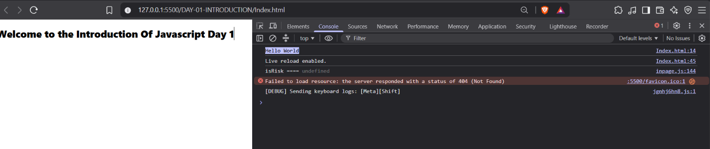

# 🚀 Day 01 — JavaScript Introduction

Welcome to **Day 01 of my 30 Days of JavaScript Challenge!** 🎯

In this challenge, I will learn and practice JavaScript concepts by building small practical programs.

## 📌 Today's Topic

# What is JavaScript 
-javascript is just a high level (human understable) programming language for web application.
-It primarily used to add dynamic interactivity and complex functionality of web.

# It can be used for:

- 🌐 Web Development
- ⚛️ Frontend Development
- 🖥️ Backend Development with Node.js
- 📱 Mobile Applications
- 🤖 AI Applications
- 🎮 Games
- 🔧 Automation

# Who to use JavaScript
 -There are mainly two ways:

 1. Internal Linking :
    -Write the javaScript code inside the HTML file
    -using <script src="index.js"> tag

2. External Linking :
    -Write the javaScript code in seprate .js file
    -You can create seprate index.js file as well

    ## Output

